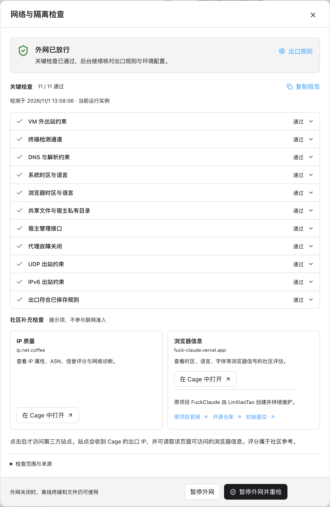
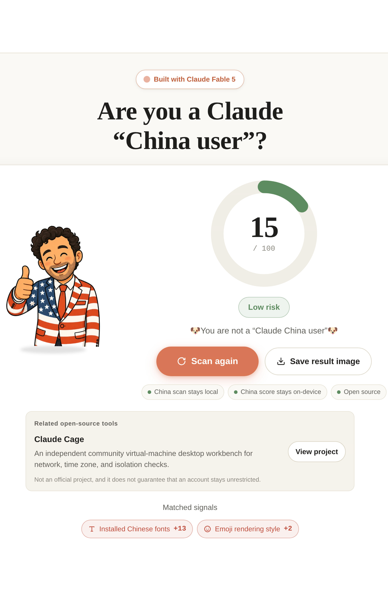

<div align="center">

<h1>Claude Cage</h1>

**Трымайце міс Клод у клетцы, каб мы маглі лепш абараніць наш час разам**


[](https://github.com/Lee-xeo/Claude-Cage/releases) [](LICENSE)

<a href="https://trendshift.io/repositories/339051#achievements"></a> <a href="https://trendshift.io/repositories/339051#achievements"></a>

<a href="https://trendshift.io/repositories/339051#achievements"></a> <a href="https://trendshift.io/repositories/339051#achievements"></a>

**[Сайт праекта](https://claude-cage.com/) · [Спампаваць праграму](https://claude-cage.com/be/#download) · [Пачатак працы](docs/getting-started.md) · [FAQ](docs/troubleshooting.md) · [Дапаможнік (па-кітайску)](https://claude-cage.com/docs/)**

[简体中文](README.md) · [繁體中文](README.zh-TW.md) · [Русский](README.ru.md) · [العربية](README.ar.md) · [فارسی](README.fa.md) · [한국어](README.ko.md) · [Español](README.es.md) · [မြန်မာဘာသာ](README.my.md) · [Беларуская](README.be.md) · [پښتو](README.ps.md) · [دری](README.prs.md) · [አማርኛ](README.am.md) · [Soomaali](README.so.md) · [ትግርኛ](README.ti.md) · [Français](README.fr.md)

</div>

## Філасофія праектавання

1. **Сам Claude бяспечны, але яго абалонка (harness) і спадарожныя праграмы — не**: гэта Claude Code, Claude Desktop, а таксама лісты, вэб-старонкі і сігналы асяроддзя ў браўзеры.
2. **Каб бяспечна карыстацца магчымасцямі Claude, звычайна ёсць два шляхі: зваротны проксі або аддаленае кіраванне** — альбо вынесці Claude з сервера непасрэдна на хост, альбо разгарнуць яго ў ізаляваным асяроддзі, адкуль ён кантралявана кіруе хостам. Мы лічым другі шлях больш бяспечным і адпаведным патрабаванням.
3. **Таму галоўная ідэя Cage — стварыць лёгкае лакальнае ізаляванае асяроддзе для праграм Claude і праз стандартныя плагіны MCP даць Claude бяспечны, кантраляваны доступ да хоста** — з яўнымі дазволамі і пацвярджэннем карыстальніка, бяспечней за прамы SSH.

Такім чынам Cage адначасова вырашае тры задачы:

- **Ізаляваць небяспечнае, адкрыць карыснае.** Спадарыня Клод спакойна сядзіць на сваім крабіку ўнутры Cage і проста працягвае руку для працы звонку — не трэба наноў будаваць цэлы офіс унутры клеткі.
- **Незалежнае супрацоўніцтва з open-source супольнасцю праз краму плагінаў.** У адкрытай [краме плагінаў (cage-plugins)](https://github.com/Lee-xeo/cage-plugins) **плагін = MCP + пашырэнне**: MCP дае здольнасці Claude, а пашырэнне наладжвае сам Cage. Супольнасць развівае інструменты і панэлі ў краме плагінаў, не перагружаючы спіс Issue асноўнага рэпазіторыя, а каманда Cage засяроджваецца на ядры асяроддзя і сеткі.
- **Адпаведнасць патрабаванням, бяспека, лёгкасць, лакальнасць і нізкі кошт з скрынкі.** Больш не трэба падтрымліваць складаныя шматсістэмныя гасцявыя АС, баяцца абмежаванняў Claude, пераплачваць за воблака або хвалявацца за даныя — усё працуе элегантна на вашым камп’ютары.

## Надакучыла Anthropic

Як звычайныя карыстальнікі, якія проста хочуць паразмаўляць і супрацоўнічаць з Клодам, мы стаміліся ад наладжвання асобнікаў VPS, профіляў адбіткаў пальцаў у браўзеры і праверкі асяроддзя, адначасова турбуючыся аб забароне ўліковых запісаў і фінансавых стратах. Мы прадстаўляем **Claude Cage** — **гатовае да выкарыстання настольнае прыкладанне: наладзьце свой уласны сеткавы проксі і кіруйце лёгкім ізаляваным асяроддзем, гадзінным поясам, мовай, праверкай асяроддзя і плагінамі ў адным месцы.**

Claude Cage аб’ядноўвае тэрмінал, браўзер, рэдактар, афіцыйны Claude Desktop і краму плагінаў у адным ізаляваным працоўным асяроддзі. На macOS, Windows і Linux выкарыстоўваецца адно і тое ж лёгкае асяроддзе Debian 13. Адкрывайце доступ да выбраных праектаў, кіруйце сеткай асобна, бяспечна выкарыстоўвайце інструменты камп’ютара праз плагіны, падключайце свой сервер праз SSH і працягвайце працу з тэлефона. Асноўныя магчымасці:

- Налады сеткі ізаляваны ад хаста; Cage накіроўвае ўвесь сеткавы трафік унутр свайго асяроддзя праз уласны сеткавы проксі
- Налады адбіткаў пальцаў браўзера, ізаляваныя ад хаста, уключаючы гадзінны пояс і мову, з аўтаматычнай сінхранізацыяй з IP-месцазнаходжаннем сеткавага проксі
- Інтэграцыя ва ўвесь працоўны працэс Claude: уваход у браўзер, аўтарызацыя ўліковага запісу і працэс Claude Code
- Убудаваныя праверкі сеткі і ізаляцыі прыпыняюць доступ у Інтэрнэт, калі крытычныя праверкі не атрымліваюцца або доказы няпоўныя; праверкі супольнасці і трэціх асоб даюць дадатковую даведачную інфармацыю

**Вынікі праверкі асяроддзя з Cage:**

| Праверка сеткі і ізаляцыі | Праверка браўзера ад супольнасці |
| :---: | :---: |
| <a href="assets/network-checks.png"></a> | <a href="assets/community-browser-check.png"></a> |

[FuckClaude](https://fuck-claude.vercel.app/) · [LinXiaoTao / GitHub](https://github.com/LinXiaoTao/FuckClaude)

**Асноўны інтэрфейс Cage:**


## Што ты можаш зрабіць з Cageам

- **Запускайце Claude Code з тэрмінала свайго камп’ютара (v0.2.2).** Каманда `cage login` адкрывае браўзер Cage для ўваходу ва ўліковы запіс Claude. Запусціце `cage claude` у каталогу праекта, каб адкрыць да яго доступ і пачаць сеанс з прадвызначаным уліковым запісам. Калі вы далі ўліковаму запісу імя `sarah`, каманда `cage sarah` выбера яго толькі для гэтага запуску. Каманда `cage` без аргументаў паказвае даведку. Каманда `cage start` запускае службу Cage і лакальную віртуальную машыну ў фонавым рэжыме і чакае гатоўнасці асяроддзя. Каманда `cage up` адкрывае праграму Cage або выводзіць яе акно на пярэдні план. Каб абнавіць Cage з тэрмінала, запусціце `cage update`. Пасля публікацыі пакета npm для v0.2.2 яго можна будзе ўсталяваць камандай `npm install -g claude-cage`. [Каманды і прыклады](docs/guide/workbench.md#在本机终端使用-claude-code)
- **Праца ў адным акне.** Запусціце Claude Code у тэрмінале, праглядзіце змены ў рэдактары і выкарыстоўвайце браўзер Cage для папярэдняга прагляду паслуг і ўваходу.
- **Адкрыйце ўсе магчымасці праз краму плагінаў.** Убудаваная адкрытая [крама плагінаў (cage-plugins)](https://github.com/Lee-xeo/cage-plugins) па прынцыпе «плагін = MCP + пашырэнне» дазваляе Claude бяспечна і пад вашым кантролем карыстацца інструментамі камп’ютара (кіраванне экранам і клавіятурай/мышшу, дакументы Office, Blender, каманды) і дадаваць уласныя старонкі ў Cage з яўным пацвярджэннем дазволаў. [Кіраўніцтва па плагінах](docs/guide/plugins.md) · [Спецыфікацыя](docs/plugins.md)
- **Адно лёгкае асяроддзе на ўсіх платформах.** Cage на macOS, Windows і Linux выкарыстоўвае адно і тое ж лёгкае асяроддзе Debian 13 без складаных шматсістэмных гасцявых АС, з аднолькавымі інструментамі і парадкам працы. [Асяроддзе Debian](docs/guide/guest-systems.md)
- **Кантралюйце, чым вы дзеліцеся.** Абагульваюцца толькі працоўная вобласць па змаўчанні і адкрытыя папкі праекта. Стан уваходу Claude, профілі браўзера і ключы SSH не імпартуюцца аўтаматычна.
- **Глядзіце стан вашай сеткі.** Убудаванае кіраванне сеткавым проксі-серверам дазваляе імпартаваць падпіскі, выбіраць канчатковыя кропкі і правяраць выхадны IP. Асяроддзе застаецца ў аўтаномным рэжыме, пакуль не пройдуць крытычныя праверкі. Калі сеткавы проксі-сервер недаступны, няма магчымасці вярнуцца да прамога злучэння.
- **Працягнуць у наступны раз.** Інструменты, файлы і стан уваходу захоўваюцца на віртуальным дыску. Фонавыя задачы могуць працягваць працаваць, калі вы зачыніце акно.
- **Кіруйце некалькімі акаўнтамі Claude Code.** Правярайце квоты, прызначайце акаўнты новым сеансам і з яўным дазволам мяняйце акаўнт з захаваннем гісторыі. [Claude Code](docs/guide/accounts.md)
- **Працягвайце з тэлефона.** Падключыце Android ці iPhone да камп’ютара праз QR-код або код спалучэння. Працягвайце тыя ж размовы Claude Code, адпраўляйце паведамленні, пацвярджайце інструменты і кіруйце аддаленым браўзерам ці акном Claude Desktop на камп’ютары.
- **Запускайце Cage у воблаку.** Падключайцеся праз SSH да Cage на сумяшчальным VPS з Linux x86_64 без KVM. Даныя і выхад у сетку знаходзяцца на серверы.
- **Падключайцеся праз прыватную сетку.** Увайдзіце ў Tailscale ўнутры Cage для двухбаковага SSH паміж хостам і асяроддзем. [Tailscale / SSH](docs/guide/tailscale.md)

## Хуткі старт

Адпраўце гэты запыт свайму агенту штучнага інтэлекту (codex, dsh, workbuddy — верагодна, не Claude Code 😁):

```markdown
Атрымай апошні зыходны код https://github.com/Lee-xeo/Claude-Cage, збяры пакет і ўсталюй яго. Імпартуй у Cage канфігурацыю вузла з майго файла [шлях]. Калі выкарыстоўваецца ланцужок проксі, наладзь спачатку прамежкавы вузел, затым выхадны. Правер, што публічны IP-адрас на выхадзе супадае з [чаканы IP]. Сачы за ўсім працэсам, адразу выпраўляй праблемы і пры неабходнасці ствары issue ў праекце, каб палепшыць сумяшчальнасць.
```

Лакальны адрас, на якім Clash/Mihomo або sing-box прымае злучэнні, напрыклад `127.0.0.1:7890`, нельга выкарыстоўваць як вузел проксі. [Перанос ланцужка проксі](docs/guide/network.md#把原客户端的代理链迁到-cage)

Усё, што вам трэба, гэта надзейная канчатковая кропка сеткавага проксі. Гэты праект не прасоўвае ніякіх проксі-правайдэраў; вы можаце знайсці пастаўшчыка самастойна, напрыклад, здзейсніўшы пошук на сайце Black Error.

## Спампоўка і ўстаноўка

Cage падтрымлівае macOS, Windows і Linux: Apple Silicon і Intel Mac з macOS 14+, Windows 10 22H2 / 11 x64 і Debian 12 / Ubuntu 22.04 / 24.04 x86_64. Windows ARM64 і Linux ARM64 пакуль не падтрымліваюцца. [macOS](docs/getting-started.md) · [Windows](docs/windows.md) · [Linux](docs/linux.md).

1. Спампаваць праграму: [macOS / Windows / Linux](https://claude-cage.com/be/#download).
2. macOS: Адкрыйце ўсталявальны пакет і перацягнуць **Cage** у **Прыкладанні**; затым запусціце яго з праграм. Windows: [Інструкцыя па ўсталяванні](docs/windows.md#安装并开始工作) · Linux: [Інструкцыя па ўсталяванні](docs/linux.md#安装并开始工作).
3. Выконвайце інструкцыі ў дадатку, каб наладзіць свой уласны сеткавы проксі, запусціць асяроддзе і адкрыць праект.

Усталёўшчык змяшчае працоўнае асяроддзе і ядро проксі. Загадзя ўсталёўваць Go, Node.js, Docker ці Clash не трэба. Пры стварэнні асяроддзя выберыце месца захоўвання; Cage спампуе вобраз Debian 13 і інструменты распрацоўкі. Cage не дае паслуг проксі ці акаўнтаў Claude.

Зыходны код і ўсталёўшчыкі публічныя. Заўвагі да версій і кантрольныя сумы даступныя ў [Releases](https://github.com/Lee-xeo/Claude-Cage/releases).

Магчымасці залежаць ад зборкі; магчымасці і аб’ём праверкі публічнага ўсталёўшчыка пазначаны ў нататках да выпуску.

macOS і падпісаныя версіі Windows абнаўляюцца праз выбраны проксі. Непадпісаная папярэдняя версія Windows і Linux абнаўляюцца ўручную ўсталёўшчыкам. Перад абнаўленнем захавайце і спыніце задачы; асабістыя даныя захоўваюцца. [Абнаўленне і выдаленне](docs/guide/maintenance.md)

## Пачніце ў тры этапы

### 1. Выберыце сеткавы проксі

На галоўнай старонцы націсніце «Наладзіць сетку і проксі», затым «Дадаць крыніцу». Імпартуйце падпіску Clash/Mihomo YAML або лакальны файл YAML і абярыце канечную кропку ў раздзеле «Вузлы». Калі сеткавы проксі недаступны, вы можаце яўна выбраць «Спампаваць гэтую падпіску праз хаст-сетку» або непасрэдна імпартаваць лакальны файл. Пазней кіруйце канчатковымі кропкамі ў раздзеле «Настройкі → Сетка і проксі».

### 2. Пачаць асяроддзе

Пры першым запуску выберыце месца захоўвання. Запусціце асяроддзе Cage, завяршыце ўсталяванне і патрэбныя дазволы. Прагрэс і памылкі даступныя ў дэталях аперацыі. Наступныя запускі выкарыстоўваюць тое ж асяроддзе.

### 3. Адкрыйце праект і запусціце Claude

Націсніце «Адкрыць праект», каб выбраць тэчку на вашым камп’ютары, адкрыць новы тэрмінал і ўвайсці `claude`; затым аўтарызуйце свой уліковы запіс у браўзеры Cage. Вы таксама можаце пачаць з працоўнай вобласці па змаўчанні без падрыхтоўкі праекта. Поўныя крокі гл [Пачатак працы](docs/getting-started.md).

## Зразумейце гэтыя абмежаванні перад выкарыстаннем

- Рэдагаванні і выдаленні ў агульных праектах непасрэдна ўплываюць на файлы на вашым камп’ютары. Выкарыстоўвайце кантроль версій або рэзервовыя копіі. Каталог `.git` праекта даступны для чытання і запісу; у Cage можна індэксаваць змены, ствараць каміты і пераключаць галіны.
- Усе праекты выкарыстоўваюць адно асяроддзе Cage, уключаючы яго інструменты, уліковыя запісы і файлавую сістэму Debian. Праекты не ізаляваныя адзін ад аднаго.
- Па змаўчанні публічны выходны трафік падтрымлівае IPv4 TCP, а DNS ідзе праз той жа проксі. Публічныя UDP, IPv6, ICMP і прамы доступ да хоста або лакальнай сеткі абмежаваныя. Пасля яўнага ўключэння Tailscale доступ да прылад вызначаюць правілы прыватнай сеткі.
- Сеткавыя праверкі паказваюць бягучую канфігурацыю і выбарку доказаў. Яны не могуць гарантаваць, што ўліковы запіс пазбегне абмежаванняў платформы, і не замяняюць поўны аўдыт бяспекі віртуалізацыі.

Падрабязней гл [Межы сеткі і дадзеных](docs/getting-started.md#网络与数据边界).

## Дакументацыя і ўклады

Поўны паказальнік гл [Індэкс дакументацыі](docs/README.md).

| Ваша задача | Пачаць тут |
|---|---|
| Debian 13 | [Асяроддзе Debian](https://claude-cage.com/docs/guest-systems/) |
| Усталюйце, наладзьце сеткавы проксі і адкрыйце свой першы праект | [Пачатак працы](docs/getting-started.md) |
| Выпраўленне непаладак спампоўкі, запуску, падключэння і ўваходу ў сістэму | [FAQ і аднаўленне](docs/troubleshooting.md) |
| Вывучыце элементы кіравання з клавіятуры, знешні выгляд, захаванне даных і паводзіны пры выхадзе | [Штодзённае выкарыстанне](docs/getting-started.md#日常使用) |
| Паведаміць аб узнаўляльнай праблеме | [GitHub Issues](https://github.com/Lee-xeo/Claude-Cage/issues) |
| Унесці выпраўленне, функцыю або дакументацыю: праверка Issue → запрашэнне суаўтара → PR | [Кіраўніцтва для ўдзельнікаў (кітайская)](.github/CONTRIBUTING.md) |

Праект імкліва развіваецца. Далучайцеся да групы супольнасці, каб падзяліцца водгукамі; вітаюцца супрацоўнікі супольнасці.

| QQ group · 782087179 | WeChat |
| :---: | :---: |
| <a href="assets/community-qq.png"></a> | <a href="www/src/assets/community-wechat.png"></a> |

[Telegram](https://t.me/claude_cage)

## Паходжанне і ліцэнзаванне

Клетка паходзіць ад [agent-vm](https://github.com/sylvinus/agent-vm).

Асноўная ліцэнзія праекта [MIT](LICENSE). Кампаненты ў камплекце захоўваюць адпаведныя ліцэнзіі. Mihomo распаўсюджваецца як асобны выкананы файл пад GPL-3.0. Таксама гл [NOTICE](NOTICE) · [Ліцэнзіі іншых вытворцаў](THIRD_PARTY_LICENSES) · [noVNC](ui/vendor/novnc/LICENSE.txt)。

Cage з'яўляецца незалежным грамадскім праектам і не звязаны з Anthropic.

## Спасылкі і падзякі

Дзякуй наступным праектам за асноўныя магчымасці і дызайнерскія спасылкі:

- [agent-vm](https://github.com/sylvinus/agent-vm): верхні падмурак Cageа.
- [Lima](https://github.com/lima-vm/lima): Кіраванне віртуальнай машынай Linux.
- [gvisor-tap-vsock](https://github.com/containers/gvisor-tap-vsock): сетка віртуальнай машыны.
- [sshocker](https://github.com/lima-vm/sshocker) і [SFTP](https://github.com/pkg/sftp): абмен файламі паміж віртуальнай машынай і хостам.
- [noVNC](https://github.com/novnc/noVNC): дыстанцыйнае адлюстраванне і ўзаемадзеянне ў браўзеры.
- [Mihomo](https://github.com/MetaCubeX/mihomo): убудаванае сеткавае ядро ​​проксі.
- [code-server](https://github.com/coder/code-server): рэдактар ​​кода на аснове браўзера.
- [AIO Sandbox](https://github.com/agent-infra/sandbox): спасылкі на дызайн працоўнага асяроддзя і ўзаемадзеяння.
- [claude-switcher](https://github.com/YOURSJEYO/claude-switcher) і [Claude-Guardian](https://github.com/DUNHKpcc/Claude-Guardian): спасылкі для праверкі сеткі і дыягностыкі бяспекі.
- [claude-post-ban-cleanup](https://github.com/l2461090/claude-post-ban-cleanup): прыклад дакладнай інвентарызацыі, абароны даных і ачысткі кэша з аднаўленнем; незалежная рэалізацыя ў Cage.


<a href="https://www.star-history.com/?repos=Lee-xeo%2FClaude-Cage&amp;type=date">
  <picture>
    <source media="(prefers-color-scheme: dark)" srcset="https://api.star-history.com/svg?repos=Lee-xeo/Claude-Cage&amp;type=Date&amp;theme=dark" />
    <source media="(prefers-color-scheme: light)" srcset="https://api.star-history.com/svg?repos=Lee-xeo/Claude-Cage&amp;type=Date" />
    
  </picture>
</a>
