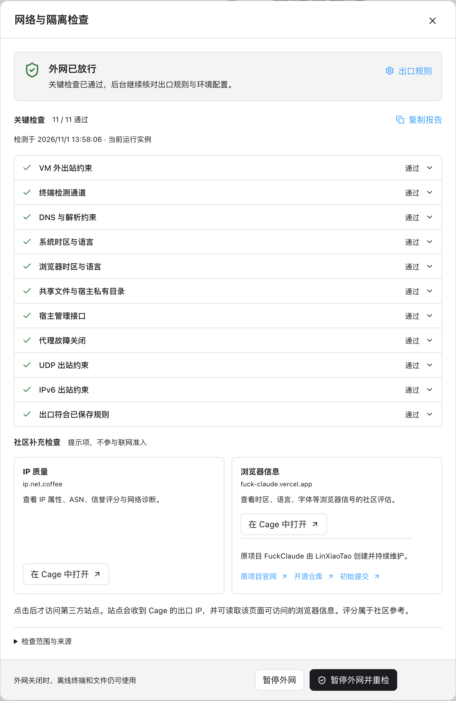
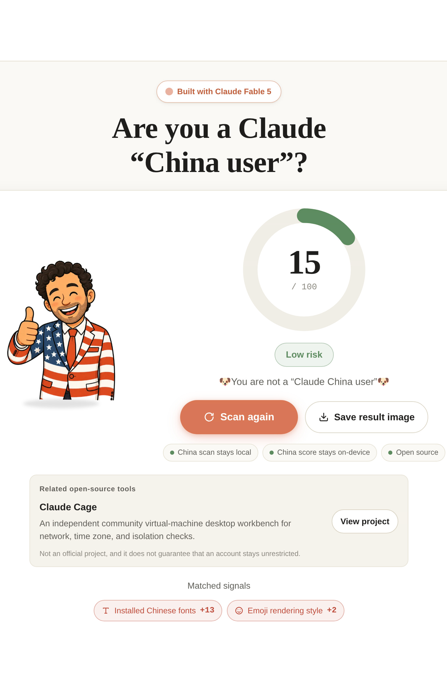
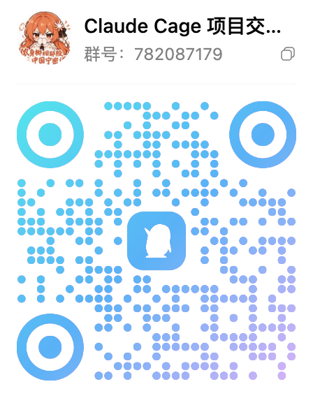
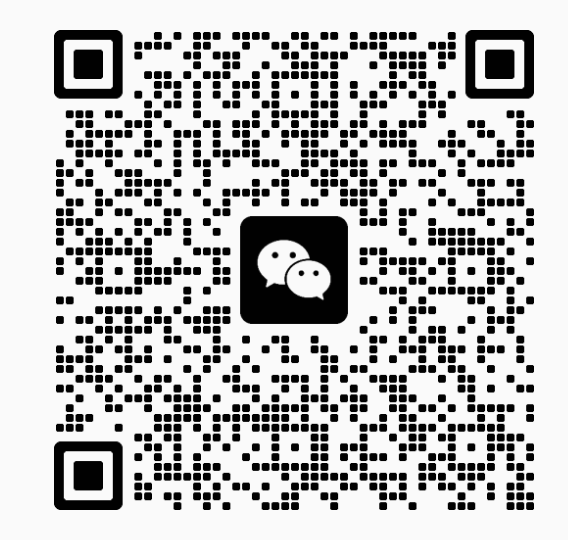

<div align="center">

<h1>Claude Cage</h1>

**Gardez Miss Claude dans une cage pour que nous puissions mieux protéger notre temps ensemble**


[](https://github.com/Lee-xeo/Claude-Cage/releases) [](LICENSE)

<a href="https://trendshift.io/repositories/339051#achievements"></a> <a href="https://trendshift.io/repositories/339051#achievements"></a>

<a href="https://trendshift.io/repositories/339051#achievements"></a> <a href="https://trendshift.io/repositories/339051#achievements"></a>

**[Site Web du projet](https://claude-cage.com/) · [Télécharger l’application](https://claude-cage.com/fr/#download) · [Commencer](docs/getting-started.md) · [FAQ](docs/troubleshooting.md) · [Guide d’utilisation (chinois)](https://claude-cage.com/docs/)**

[简体中文](README.md) · [繁體中文](README.zh-TW.md) · [Русский](README.ru.md) · [العربية](README.ar.md) · [فارسی](README.fa.md) · [한국어](README.ko.md) · [Español](README.es.md) · [မြန်မာဘာသာ](README.my.md) · [Беларуская](README.be.md) · [پښتو](README.ps.md) · [دری](README.prs.md) · [አማርኛ](README.am.md) · [Soomaali](README.so.md) · [ትግርኛ](README.ti.md) · [Français](README.fr.md)

</div>

## Philosophie de conception

1. **Claude lui-même est sûr, mais son harnais (harness) et ses programmes associés ne le sont pas** : cela inclut Claude Code, Claude Desktop, ainsi que les e-mails, pages web et signaux environnementaux reçus dans le navigateur.
2. **Pour utiliser les capacités de Claude en toute sécurité, deux approches existent généralement : le proxy inverse ou le contrôle à distance** — soit sortir Claude d’un serveur pour l’exécuter directement sur l’hôte, soit le déployer dans un environnement isolé qui pilote l’hôte de façon contrôlée. Nous pensons que la seconde approche est plus sûre et plus conforme.
3. **L’idée centrale de Cage consiste donc à fournir un environnement local léger et isolé aux programmes Claude, puis à utiliser des plugins MCP standard pour permettre à Claude d’accéder à votre ordinateur de manière sûre et contrôlée** — avec des permissions explicites et une confirmation utilisateur, plus sûr qu’un accès SSH direct.

Cage atteint ainsi trois objectifs simultanément :

- **Enfermer ce qui est risqué, libérer ce qui est utile.** Mademoiselle Claude reste confortablement dans sa cage, assise sur son petit crabe, et tend simplement la main pour accomplir le travail extérieur — sans avoir besoin de reconstruire tout un bureau à l’intérieur de Cage.
- **Collaborer de façon découplée avec la communauté open source via le marché de plugins.** Dans notre [marché de plugins ouvert (cage-plugins)](https://github.com/Lee-xeo/cage-plugins), **plugin = MCP + extension** : MCP apporte des capacités à Claude et l’extension personnalise Cage. La communauté enrichit le marché de plugins sans encombrer les issues du dépôt principal, tandis que l’équipe Cage se concentre sur le cœur du produit.
- **Conforme, sûr, léger, local, économique et prêt à l’emploi en un clic.** Plus besoin de maintenir des systèmes invités complexes, de craindre que Claude soit bridé, ni de payer des coûts cloud élevés ou de compromettre vos données : tout fonctionne localement avec élégance.

## Assez d’Anthropic

En tant qu'utilisateurs ordinaires qui souhaitent simplement parler et collaborer avec Claude, nous en avons assez de configurer des instances VPS, des profils d'empreintes digitales de navigateur et des contrôles d'environnement, tout en nous inquiétant des interdictions de compte et des pertes financières. Nous présentons **Claude Cage** — **une application de bureau prête à l'emploi : configurez votre propre proxy réseau et gérez votre environnement isolé léger, votre fuseau horaire, votre langue, vos contrôles d'environnement et vos plugins en un seul endroit.**

Claude Cage réunit terminal, navigateur, éditeur, Claude Desktop officiel et marché de plugins dans un même espace de travail isolé. Sous macOS, Windows et Linux, il utilise le même environnement Debian 13 léger. Partagez les projets de votre choix, gérez le réseau séparément, appelez des outils locaux en toute sécurité via des plugins, connectez votre serveur par SSH et poursuivez vos tâches depuis votre téléphone. Ses principales fonctions :

- Paramètres réseau isolés de l'hôte ; Cage achemine tout le trafic réseau à l'intérieur de son environnement via son propre proxy réseau
- Paramètres d'empreinte digitale du navigateur isolés de l'hôte, y compris le fuseau horaire et la langue, avec synchronisation automatique avec l'emplacement IP du proxy réseau
- Intégration tout au long du flux de travail Claude : connexion au navigateur, autorisation de compte et processus Claude Code
- Les contrôles de réseau et d'isolement intégrés interrompent l'accès à Internet lorsque les contrôles critiques échouent ou que les preuves sont incomplètes ; les contrôles communautaires et tiers fournissent des informations de référence supplémentaires

**Résultats de la vérification de l'environnement avec Cage :**

| Contrôles du réseau et de l’isolation | Contrôle communautaire du navigateur |
| :---: | :---: |
| <a href="assets/network-checks.png"></a> | <a href="assets/community-browser-check.png"></a> |

[FuckClaude](https://fuck-claude.vercel.app/) · [LinXiaoTao / GitHub](https://github.com/LinXiaoTao/FuckClaude)

**L'interface principale de Cage :**


## Ce que vous pouvez faire avec Cage

- **Utilisez Claude Code depuis le terminal de votre ordinateur (v0.2.2).** `cage login` ouvre le navigateur de Cage pour vous connecter à votre compte Claude. Lancez `cage claude` dans le dossier du projet pour le partager et ouvrir une session avec le compte par défaut. Si vous avez nommé un compte `sarah`, lancez `cage sarah` pour l’utiliser uniquement cette fois. La commande `cage` sans argument affiche l’aide. `cage start` démarre le service Cage et la machine virtuelle locale en arrière-plan, puis attend que l’environnement soit prêt. `cage up` ouvre l’application de bureau ou ramène sa fenêtre au premier plan. Pour mettre à jour Cage depuis le terminal, lancez `cage update`. Dès la publication du paquet npm v0.2.2, vous pourrez l’installer avec `npm install -g claude-cage`. [Commandes et exemples](docs/guide/workbench.md#在本机终端使用-claude-code)
- **Travaillez dans une seule fenêtre.** Exécutez Claude Code dans le terminal, examinez les modifications dans l'éditeur et utilisez le navigateur Cage pour prévisualiser les services et vous connecter.
- **Débloquez toutes les capacités avec le marché de plugins.** Le [marché de plugins ouvert (cage-plugins)](https://github.com/Lee-xeo/cage-plugins) suit la formule « plugin = MCP + extension » : Claude peut utiliser en toute sécurité et sous contrôle les outils de votre ordinateur (écran et clavier/souris, documents Office, Blender, commandes) et ajouter des vues isolées à Cage avec permissions déclarées et confirmation système. [Guide des plugins](docs/guide/plugins.md) · [Spécification](docs/plugins.md)
- **Un même environnement léger sur toutes les plateformes.** Cage utilise le même environnement Debian 13 léger sous macOS, Windows et Linux, sans maintenir plusieurs systèmes invités complexes, avec les mêmes outils et le même fonctionnement. [Environnement Debian](docs/guide/guest-systems.md)
- **Contrôlez ce que vous partagez.** Seuls l'espace de travail par défaut et les dossiers de projet explicitement ouverts sont partagés. L'état de connexion Claude de l'hôte, les profils de navigateur et les clés SSH ne sont pas importés automatiquement.
- **Consultez l'état de votre réseau.** La gestion intégrée du proxy réseau vous permet d'importer des abonnements, de sélectionner des points de terminaison et de vérifier l'adresse IP de sortie. L'environnement reste hors ligne jusqu'à ce que les vérifications critiques soient réussies. Si le proxy réseau n'est pas disponible, il n'est pas possible de recourir à une connexion directe.
- **Continuez la prochaine fois.** Les outils, les fichiers et l'état de connexion persistent sur le disque virtuel. Les tâches en arrière-plan peuvent continuer à s'exécuter lorsque vous fermez la fenêtre.
- **Gérez plusieurs comptes Claude Code.** Consultez les quotas, attribuez les comptes aux nouvelles sessions et, avec une autorisation explicite, changez de compte en conservant l’historique. [Claude Code](docs/guide/accounts.md)
- **Poursuivez depuis votre téléphone.** Associez Android ou iPhone à l’ordinateur par QR code ou code d’association. Retrouvez les mêmes conversations Claude Code, envoyez des messages, approuvez les outils et utilisez le navigateur distant ou la fenêtre Claude Desktop de l’ordinateur.
- **Exécutez Cage dans le cloud.** Connectez-vous par SSH à Cage déployé sur un VPS Linux x86_64 compatible, sans KVM. Les données et la sortie réseau restent sur le serveur.
- **Connectez-vous par un réseau privé.** Connectez Tailscale dans Cage pour accéder par SSH à l’hôte et à l’environnement dans les deux sens. [Tailscale / SSH](docs/guide/tailscale.md)

## Démarrage rapide

Envoyez cette demande à votre agent IA (codex, dsh, workbuddy — probablement pas Claude Code 😁) :

```markdown
Récupère le code source le plus récent de https://github.com/Lee-xeo/Claude-Cage, compile-le, crée le paquet et installe-le. Importe dans Cage le nœud exporté dans [chemin du fichier]. Pour une chaîne de proxys, configure le relais puis le nœud de sortie. Vérifie que l’adresse IP publique de sortie correspond à [IP attendue]. Surveille toute l’opération, corrige directement les problèmes et, si nécessaire, ouvre une issue sur le projet pour améliorer la compatibilité.
```

L’adresse d’écoute locale de Clash/Mihomo ou de sing-box, par exemple `127.0.0.1:7890`, ne peut pas servir de proxy en amont. [Migrer une chaîne de proxys](docs/guide/network.md#把原客户端的代理链迁到-cage)

Tout ce dont vous avez besoin est un point de terminaison proxy réseau fiable. Ce projet ne fait la promotion d'aucun fournisseur de proxy ; vous pouvez trouver un fournisseur vous-même, par exemple en recherchant le site Web Black Error.

## Téléchargement et installation

Cage prend en charge macOS, Windows et Linux : Apple Silicon et Intel Mac avec macOS 14+, Windows 10 22H2 / 11 x64 et Debian 12 / Ubuntu 22.04 / 24.04 x86_64. Windows ARM64 et Linux ARM64 ne sont pas encore pris en charge. [macOS](docs/getting-started.md) · [Windows](docs/windows.md) · [Linux](docs/linux.md).

1. Télécharger l’application: [macOS / Windows / Linux](https://claude-cage.com/fr/#download).
2. macOS: Ouvrez le package d'installation et faites glisser **Cage** dans **Applications**; puis lancez-le depuis Applications. Windows: [Guide d’installation](docs/windows.md#安装并开始工作) · Linux: [Guide d’installation](docs/linux.md#安装并开始工作).
3. Suivez les instructions de l'application pour configurer votre propre proxy réseau, démarrer l'environnement et ouvrir un projet.

L’installateur comprend l’espace de travail et le moteur de proxy. Inutile d’installer Go, Node.js, Docker ou Clash au préalable. À la création, choisissez l’emplacement de stockage ; Cage télécharge l’image Debian 13 et les outils de développement. Cage ne fournit ni service proxy, ni compte Claude.

Le code source et les installateurs sont publics. Consultez les notes et les sommes de contrôle dans [Releases](https://github.com/Lee-xeo/Claude-Cage/releases).

Les fonctions dépendent de la compilation utilisée ; les fonctions et les vérifications de l’installateur public sont précisées dans les notes de version.

macOS et les versions Windows signées se mettent à jour via le proxy choisi. La préversion Windows non signée et Linux utilisent l’installateur manuellement. Enregistrez et arrêtez les tâches avant la mise à jour ; les données personnelles sont conservées. [Mise à jour et désinstallation](docs/guide/maintenance.md)

## Commencez en trois étapes

### 1. Sélectionnez un proxy réseau

Sur la page d'accueil, cliquez sur « Configurer le réseau et le proxy », puis sur « Ajouter une source ». Importez un abonnement YAML Clash/Mihomo ou un fichier YAML local et sélectionnez un point de terminaison sous « Nœuds ». Si aucun proxy réseau n'est disponible, vous pouvez sélectionner explicitement « Télécharger cet abonnement via le réseau hôte » ou importer directement un fichier local. Plus tard, gérez les points de terminaison sous « Paramètres → Réseau et proxy ».

### 2. Démarrez l'environnement

À la première création, choisissez l’emplacement de stockage. Démarrez l’environnement Cage et suivez l’installation et les autorisations. La progression et les erreurs figurent dans les détails de l’opération. Les lancements suivants réutilisent le même environnement.

### 3. Ouvrez un projet et exécutez Claude

Cliquez sur « Ouvrir le projet » pour sélectionner un dossier sur votre ordinateur, ouvrez un nouveau terminal et entrez `claude`; puis autorisez votre propre compte dans le navigateur Cage. Vous pouvez également commencer avec l'espace de travail par défaut sans préparer de projet. Pour les étapes complètes, voir [Commencer](docs/getting-started.md).

## Comprendre ces limites avant utilisation

- Les modifications et suppressions dans les projets partagés affectent directement les fichiers sur votre ordinateur. Utilisez le contrôle de version ou les sauvegardes. Le dossier `.git` du projet est accessible en lecture et en écriture ; vous pouvez préparer des modifications, créer des commits et changer de branche dans Cage.
- Tous les projets partagent un environnement Cage, y compris ses outils, ses comptes et son système de fichiers Debian. Les projets ne sont pas isolés les uns des autres.
- Par défaut, les sorties publiques prennent en charge IPv4 TCP et DNS passe par le même proxy. UDP, IPv6, ICMP publics et les accès directs à l’hôte ou au réseau local sont limités. En activant Tailscale, les accès aux appareils suivent les règles du réseau privé.
- Les vérifications du réseau montrent la configuration actuelle et des échantillons de preuves. Ils ne peuvent pas garantir qu’un compte évitera les restrictions de la plateforme et ne remplacent pas un audit complet de sécurité de la virtualisation.

Pour plus de détails, voir [Limites du réseau et des données](docs/getting-started.md#网络与数据边界).

## Documentation et contributions

Pour l'index complet, voir [Index des documents](docs/README.md).

| Votre tâche | Commencez ici |
|---|---|
| Debian 13 | [Environnement Debian](https://claude-cage.com/docs/guest-systems/) |
| Installez, configurez un proxy réseau et ouvrez votre premier projet | [Commencer](docs/getting-started.md) |
| Dépanner les téléchargements, le démarrage, la connectivité et la connexion | [FAQ et récupération](docs/troubleshooting.md) |
| Apprenez les commandes du clavier, l'apparence, la persistance des données et le comportement de sortie | [Utilisation quotidienne](docs/getting-started.md#日常使用) |
| Signaler un problème reproductible | [GitHub Issues](https://github.com/Lee-xeo/Claude-Cage/issues) |
| Contribuer un correctif, une fonction ou de la documentation : examen de l’Issue → invitation comme collaborateur → PR | [Guide de contribution (chinois)](.github/CONTRIBUTING.md) |

Le projet évolue rapidement. Rejoignez le groupe communautaire pour partager vos commentaires ; les responsables de la communauté sont les bienvenus.

| QQ group · 782087179 | WeChat |
| :---: | :---: |
| <a href="assets/community-qq.png"></a> | <a href="www/src/assets/community-wechat.png"></a> |

[Telegram](https://t.me/claude_cage)

## Origines et licences

La cage est dérivée de [agent-vm](https://github.com/sylvinus/agent-vm).

La licence principale du projet est [MIT](LICENSE). Les composants groupés conservent leurs licences respectives. Mihomo est distribué sous forme d'exécutable distinct sous GPL-3.0. Voir aussi [NOTICE](NOTICE) · [Licences tierces](THIRD_PARTY_LICENSES) · [noVNC](ui/vendor/novnc/LICENSE.txt)。

Cage est un projet communautaire indépendant et n'est pas affilié à Anthropic.

## Références et remerciements

Merci aux projets suivants pour leurs capacités fondamentales et leurs références de conception :

- [agent-vm](https://github.com/sylvinus/agent-vm): la fondation amont de Cage.
- [Lima](https://github.com/lima-vm/lima): Gestion des machines virtuelles Linux.
- [gvisor-tap-vsock](https://github.com/containers/gvisor-tap-vsock): mise en réseau de machines virtuelles.
- [sshocker](https://github.com/lima-vm/sshocker) et [SFTP](https://github.com/pkg/sftp): partage de fichiers entre la machine virtuelle et l'hôte.
- [noVNC](https://github.com/novnc/noVNC): affichage à distance et interaction dans le navigateur.
- [Mihomo](https://github.com/MetaCubeX/mihomo): le noyau proxy réseau intégré.
- [code-server](https://github.com/coder/code-server): l'éditeur de code basé sur un navigateur.
- [AIO Sandbox](https://github.com/agent-infra/sandbox): références pour l'environnement de travail et le design d'interaction.
- [claude-switcher](https://github.com/YOURSJEYO/claude-switcher) et [Claude-Guardian](https://github.com/DUNHKpcc/Claude-Guardian): références pour les vérifications du réseau et les diagnostics de sécurité.
- [claude-post-ban-cleanup](https://github.com/l2461090/claude-post-ban-cleanup): référence pour l’inventaire précis, la protection des données et le nettoyage réversible du cache ; implémentation indépendante dans Cage.


<a href="https://www.star-history.com/?repos=Lee-xeo%2FClaude-Cage&amp;type=date">
  <picture>
    <source media="(prefers-color-scheme: dark)" srcset="https://api.star-history.com/svg?repos=Lee-xeo/Claude-Cage&amp;type=Date&amp;theme=dark" />
    <source media="(prefers-color-scheme: light)" srcset="https://api.star-history.com/svg?repos=Lee-xeo/Claude-Cage&amp;type=Date" />
    
  </picture>
</a>
