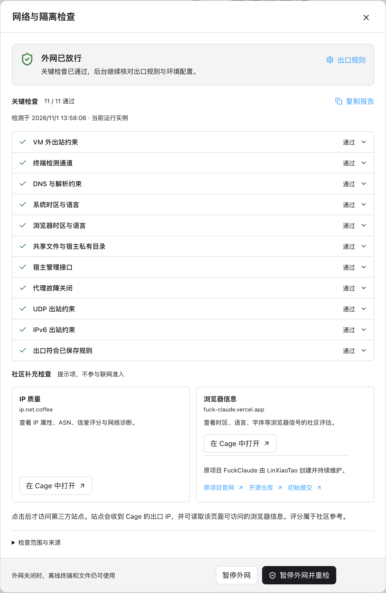
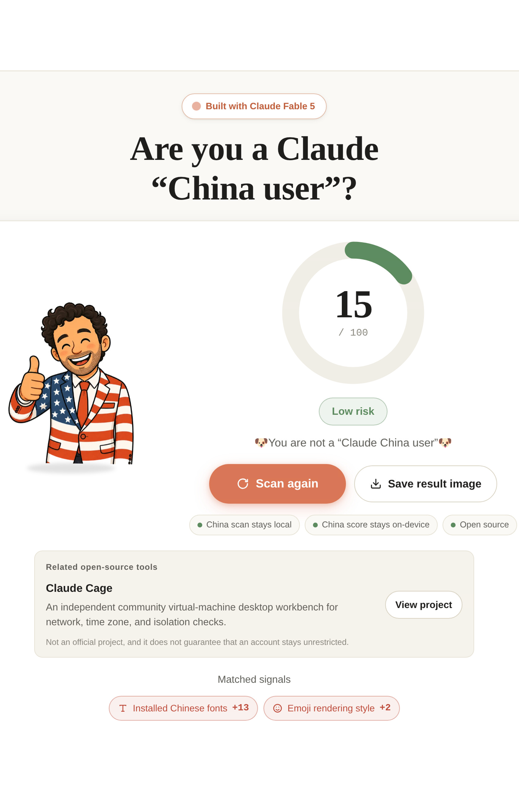

<div align="center">

<h1>Claude Cage</h1>

**把 Claude 大小姐关起来，为了更好地保护我们的相遇**


[](https://github.com/Lee-xeo/Claude-Cage/releases) [](LICENSE)

<a href="https://trendshift.io/repositories/339051#achievements"></a> <a href="https://trendshift.io/repositories/339051#achievements"></a>

<a href="https://trendshift.io/repositories/339051#achievements"></a> <a href="https://trendshift.io/repositories/339051#achievements"></a>

**[项目主页](https://claude-cage.com/) · [下载应用](https://claude-cage.com/#download) · [插件市场](https://claude-cage.com/plugins/) · [使用文档](https://claude-cage.com/docs/) · [常见问题](https://claude-cage.com/docs/troubleshooting/)**

[简体中文](README.md) · [繁體中文](README.zh-TW.md) · [Русский](README.ru.md) · [العربية](README.ar.md) · [فارسی](README.fa.md) · [한국어](README.ko.md) · [Español](README.es.md) · [မြန်မာဘာသာ](README.my.md) · [Беларуская](README.be.md) · [پښتو](README.ps.md) · [دری](README.prs.md) · [አማርኛ](README.am.md) · [Soomaali](README.so.md) · [ትግርኛ](README.ti.md) · [Français](README.fr.md)

</div>

## 设计理念

1. **Claude 本身是安全的，但它的运行外壳（harness）及相关程序不是**——包括 Claude Code、Claude Desktop，以及浏览器里接触到的邮件、网页与环境信号。
2. **想要在保证安全的前提下使用 Claude 的能力，通常有两条路线：反向代理，或者远程控制**——要么把 Claude 从远端服务器拉出来直接运行在主机上，要么把 Claude 部署在受控环境里，由它远程操作主机。我们认为后者更安全，也更合规。
3. **因此，Cage 的核心思想是：为 Claude 及相关程序打造一个轻量化的本地隔离环境，再通过标准 MCP 插件，让 Claude 安全、受控地使用本机能力**——每一次越出环境的调用都有明确的权限边界与用户确认，比直接暴露 SSH 更安全。

这样一来，Cage 同时实现了三个目标：

- **把危险的部分关起来，把有用的能力放出来。** Claude 大小姐安心待在 Cage 里，坐在她的小螃蟹上，只需把手伸出来处理外面的工作——不必在 Cage 里重新搭一整间办公室。
- **通过插件市场，与开源社区解耦协作。** 我们开放了[插件市场（cage-plugins）](https://github.com/Lee-xeo/cage-plugins)：**插件 = MCP + 扩展**，分别对应「给 Claude 的能力」与「Cage 工作台的定制化」。开源社区可以在插件市场持续贡献工具、桌面控制与工作流扩展，而不必挤进 Cage 主仓库的 Issue 列表；Cage 核心维护团队也能更聚焦于隔离环境、网络与工作台本身的打磨。
- **合规、安全、轻量化、本地、低成本，一键安装、一键配置、开箱即用。** 我们不再需要维护复杂臃肿的多系统客机，不再担心 Claude 的能力被困在孤岛里，也无需承担高昂的云端成本或数据安全隐患——在自己电脑上就能优雅地实现这一切。

## 受够了 Anthropic

作为一个只是想和 Claude 对话与合作的正常用户，受够了折腾各种 VPS，指纹浏览器，环境检测，面对封号的担惊受怕和财产损失。我们提出 **Claude Cage** 项目：**一个开箱即用的桌面程序，配置好自己的网络代理，集中管理轻量化隔离环境、时区语言、环境检查与插件能力。**

Claude Cage 在一个小型的 Debian 13 环境里运行官方 Claude Code 和 Claude Desktop，macOS、Windows 和 Linux 上都是同一个环境。终端、浏览器、编辑器、官方 Claude Desktop 与插件市场汇集在同一个工作台，项目按需共享，网络独立管理；既可以通过插件安全调用本机能力，也可以连接自己的服务器，或用手机接续电脑上的任务。支持以下几个重点功能：

- 和主机隔离的网络设置，Cage 自己接管和代理内部的所有网络流量
- 和主机隔离的指纹设置，包括时区、语言等，支持自动与代理 IP 同步
- 针对 Claude 使用过程中的全链路适配（浏览器登录，授权，claude code 进程）
- 内置网络与隔离检查，关键检查失败或证据不完整时暂停外网；社区和第三方检测提供补充参考

**使用 Cage 的环境检测结果：**

| 网络与隔离检查 | 浏览器环境检测（社区参考） |
| :---: | :---: |
| <a href="assets/network-checks.png"></a> | <a href="assets/community-browser-check.png"></a> |

[FuckClaude](https://fuck-claude.vercel.app/) · [LinXiaoTao / GitHub](https://github.com/LinXiaoTao/FuckClaude)

**Cage 运行主界面：**


## 你可以用它做什么

- **在一个窗口里完成工作。** 用终端运行 Claude Code，用编辑器查看改动，用 Cage 浏览器预览服务和完成登录。
- **通过插件市场解锁全部能力。** 内置开放的[插件市场（cage-plugins）](https://github.com/Lee-xeo/cage-plugins)，插件 = MCP + 扩展：既能让环境里的 Claude 通过标准 MCP 安全、受控地使用本机能力（如桌面键鼠控制、Office 文档、Blender、命令行工具等），也能通过沙箱页面定制 Cage 工作台。主机插件默认受权限声明与弹窗确认保护。 [插件与插件市场](docs/guide/plugins.md) · [开发规范](docs/plugins.md)
- **三个平台，同一个轻量化环境。** macOS、Windows 和 Linux 上的 Cage 都运行同一个轻量化 Debian 13 环境，无需维护复杂的多系统客机，工具与操作方式一致。 [Debian 环境](docs/guide/guest-systems.md)
- **控制共享范围。** 只共享默认工作区和明确打开的项目文件夹；主机的 Claude 登录、浏览器配置和 SSH 密钥不会自动导入。
- **看清网络状态。** 内置代理管理支持导入订阅、选择节点和检查出口。关键检查未通过时，环境保持离线；代理不可用时没有直连回退。
- **下次继续使用。** 工具、文件和登录状态保存在虚拟磁盘里，关闭窗口可以保留后台任务。
- **管理多个 Claude Code 订阅。** 查看额度、为新会话分配账号，并在明确授权后切换账号接续历史。 [Claude Code](docs/guide/accounts.md)
- **从手机继续处理任务。** Android / iPhone 配对电脑，接续 Claude Code 对话与工具审批，或操作远程浏览器和 Claude Desktop。 [手机连接](docs/guide/mobile.md)
- **把环境放到自己的服务器。** 通过 SSH 部署或连接 Linux VPS，工具、任务和数据留在服务器，无需 KVM。 [云端部署与 SSH](docs/guide/cloud.md)
- **通过私网连接设备。** 在 Cage 内登录 Tailscale，查看网络中的设备，使用 SSH、Web 与其他 TCP 服务。 [Tailscale 私网](docs/guide/tailscale.md)

浏览器收藏、无痕会话、Cookie、扩展、密码保险箱，以及外观、资源、存储和工具更新，见[完整使用文档](https://claude-cage.com/docs/)。

## 快速开始

把这句话发给你的 agent（codex，dsh，workbuddy，反正不会是 claude code😁）

```markdown
帮我拉取 https://github.com/Lee-xeo/Claude-Cage 的最新源码，打包安装，并把 Cage 的代理配置通过我本机 clash 的 xx 节点走我的 xx ip 出口，全过程你盯着，有问题直接修复，且有必要的话顺手给项目提交 issue 帮助他们优化兼容性。
```

你唯一需要的，是一个靠谱的代理节点，本项目不做任何代理推广，可以自行搜索黑色错误网站解决。

## 下载与安装

Cage 支持 macOS、Windows 和 Linux：macOS 14+ 的 Apple Silicon Mac 与 Intel Mac、Windows 10 22H2 / 11 x64，以及 Debian 12 / Ubuntu 22.04 / 24.04 x86_64。Windows ARM64 和 Linux ARM64 暂不支持。 [macOS](docs/getting-started.md) · [Windows](docs/windows.md) · [Linux](docs/linux.md)。

1. 打开[项目主页](https://claude-cage.com/#download)，点击“下载应用”并选择平台。
2. macOS：打开安装包，将 **Cage** 拖入 **Applications（应用程序）**，再从“应用程序”启动。Windows：[安装说明](docs/windows.md#安装并开始工作) · Linux：[安装说明](docs/linux.md#安装并开始工作)。
3. 按应用内引导配置自己的代理，启动环境后打开项目。

安装包随附工作台和代理核心，无需先安装 Go、Node.js、Docker 或 Clash。首次创建环境时选择存储位置，Cage 会下载 Debian 13 镜像和开发工具。Cage 不提供代理服务或 Claude 账户。

Windows 安装向导和 Cage 首次打开时按主机的显示语言预选界面语言，第一屏可以改选。支持的语言见上方列表，之后也可在「设置 → 通用 → 界面语言」切换。 [界面语言说明](docs/guide/settings.md#界面语言)

源码与安装包公开，版本说明和校验文件见 [GitHub Releases](https://github.com/Lee-xeo/Claude-Cage/releases)。从源码构建工作台需安装 `uv`，平台工具详见[构建说明](.github/CONTRIBUTING.md#工作台构建)。环境的要求、镜像来源与数据保留方式见[Debian 环境](docs/guide/guest-systems.md)。Intel Mac 的构建与验证见 [Intel Mac 说明](docs/intel-macos-development.md)。

功能以所用构建为准，公开安装包的能力与验证范围以发行说明为准。

macOS 和已签名 Windows 版本支持通过所选代理更新；Windows 未签名预览版与 Linux 使用安装包手动更新。更新前保存并停止任务，个人数据继续保留。 [升级与卸载](docs/guide/maintenance.md)

## 三步开始

### 1. 选择代理

导入 Clash/Mihomo YAML 订阅或本地配置，选择节点并点击“应用代理”；需要中转时可配置链式代理。[网络与代理](docs/guide/network.md)

### 2. 启动环境

首次启动时选择存储位置，点击“启动 Cage 环境”，按引导完成安装；进度和错误可在“操作详情”查看。以后启动复用原环境。

### 3. 打开项目，运行 Claude

点击“打开项目”选择本机上的文件夹，再新建终端，输入 `claude`，在 Cage 浏览器中完成自己的账户授权。也可以先使用默认工作区，无需提前准备项目。完整步骤见[开始使用](docs/getting-started.md)。

## 使用前了解这些边界

- 共享项目中的修改和删除直接影响本机原文件，包括 Git 操作。请使用版本控制或备份，并核对提交结果。
- 同一份 Cage 配置中的项目共用同一个 Debian 环境及其中的工具、账户与文件系统，项目之间没有独立隔离。
- 默认公网出站支持 IPv4 TCP，DNS 通过同一代理；公网 UDP、IPv6、ICMP 及主机和局域网直连受限。主动启用 Tailscale 后，可按私网权限连接设备。
- 网络检查展示当前配置和采样证据，无法保证账户不会受到平台限制，也不能代替完整的虚拟化安全审计。

详细机制见[网络与数据边界](docs/getting-started.md#网络与数据边界)。

## 文档与贡献

面向用户的[官网使用文档](https://claude-cage.com/docs/)支持按功能浏览、搜索与章节直达。各项操作见[使用文档导航](docs/README.md)。

| 你要做什么 | 从这里开始 |
|---|---|
| 让自己的 Agent 下载、安装、配置和排查 Cage | [Agent 使用指南](https://claude-cage.com/docs/agent/) |
| 第一次安装、配置代理、打开项目 | [安装与首次启动](https://claude-cage.com/docs/installation/) |
| 了解 Debian 环境的要求、空间与数据保留 | [Debian 环境](https://claude-cage.com/docs/guest-systems/) |
| 安装市场插件、管理主机授权与权限边界 | [插件与插件市场](https://claude-cage.com/docs/plugins/) |
| 开发 MCP 工具或自定义页面插件并上架 | [插件开发规范](docs/plugins.md) |
| 浏览与提交社区插件到开放市场 | [cage-plugins 插件市场](https://github.com/Lee-xeo/cage-plugins) |
| 添加多个订阅、查看额度和分配终端 | [多账号与额度](https://claude-cage.com/docs/accounts/) |
| 手机扫码、工具审批、远程浏览器 | [手机连接与远程会话](https://claude-cage.com/docs/mobile/) |
| 在自己的 VPS 部署和连接环境 | [云端部署与 SSH](https://claude-cage.com/docs/cloud/) |
| 了解每一项设置及何时生效 | [设置参考](https://claude-cage.com/docs/settings/) |
| 维护存储、资源、更新与备份 | [维护、资源与数据](https://claude-cage.com/docs/maintenance/) |
| 处理下载、启动、联网和登录问题 | [故障排查](https://claude-cage.com/docs/troubleshooting/) |
| 了解文件、按键和关闭与退出行为 | [项目、终端与文件](https://claude-cage.com/docs/workbench/) |
| 报告可复现问题 | [GitHub Issues](https://github.com/Lee-xeo/Claude-Cage/issues) |
| 提交修复、功能实现或文档改进 | [贡献指南](.github/CONTRIBUTING.md) |

想要为 Claude 接入新的 MCP 能力或为 Cage 制作扩展页面？欢迎直接前往 [cage-plugins](https://github.com/Lee-xeo/cage-plugins) 提交插件，与 Cage 主仓库解耦协作。

Cage 核心代码与文档贡献采用“`contribution` Issue 审核 → 邀请成为协作者 → 提交 PR → 审查合入”的流程。请先提交[方案贡献 Issue](https://github.com/Lee-xeo/Claude-Cage/issues/new?template=05-contribution.yml)；维护者审核通过并添加 `accepted` 标签后，自动化会发送协作者邀请。接受邀请后再创建 PR，详细步骤与权限说明见[贡献指南](.github/CONTRIBUTING.md)。

本项目仍在快速迭代中，欢迎加入交流群提意见，欢迎社区大佬一起维护与共建插件生态

| QQ 群 · 273237690 | 微信 |
| :---: | :---: |
| <a href="assets/community-qq.png"></a> | <a href="www/src/assets/community-wechat.png"></a> |

[Telegram](https://t.me/claude_cage)

## 来源与许可

Cage 基于 [agent-vm](https://github.com/sylvinus/agent-vm) 二次开发。

项目主许可为 [MIT](LICENSE)。随附组件保留各自许可，Mihomo 作为独立可执行文件按 GPL-3.0 分发；请同时参阅 [NOTICE](NOTICE) · [第三方许可](THIRD_PARTY_LICENSES) · [noVNC](ui/vendor/novnc/LICENSE.txt)。

Cage 是独立社区项目，与 Anthropic 无隶属关系。

## 参考与致谢

感谢以下项目为 Cage 提供基础能力或设计参考：

- [agent-vm](https://github.com/sylvinus/agent-vm)：Cage 的二次开发底座。
- [Lima](https://github.com/lima-vm/lima)：虚拟机管理与 Linux 环境的运行基础。
- [gvisor-tap-vsock](https://github.com/containers/gvisor-tap-vsock)：虚拟机网络能力。
- [sshocker](https://github.com/lima-vm/sshocker) 和 [SFTP](https://github.com/pkg/sftp)：虚拟机与主机之间的文件共享能力。
- [noVNC](https://github.com/novnc/noVNC)：浏览器中的远程画面与交互。
- [Mihomo](https://github.com/MetaCubeX/mihomo)：内置代理核心。
- [code-server](https://github.com/coder/code-server)：浏览器中的代码编辑器。
- [AIO Sandbox](https://github.com/agent-infra/sandbox)：工作环境和交互体验参考。
- [claude-switcher](https://github.com/YOURSJEYO/claude-switcher) 和 [Claude-Guardian](https://github.com/DUNHKpcc/Claude-Guardian)：网络检查和安全诊断方法参考。
- [claude-post-ban-cleanup](https://github.com/l2461090/claude-post-ban-cleanup): 精确盘点、保护用户资料与可恢复缓存清理的流程参考；Cage 独立实现。

<a href="https://www.star-history.com/?repos=Lee-xeo%2FClaude-Cage&amp;type=date">
  <picture>
    <source media="(prefers-color-scheme: dark)" srcset="https://api.star-history.com/svg?repos=Lee-xeo/Claude-Cage&amp;type=Date&amp;theme=dark" />
    <source media="(prefers-color-scheme: light)" srcset="https://api.star-history.com/svg?repos=Lee-xeo/Claude-Cage&amp;type=Date" />
    
  </picture>
</a>
