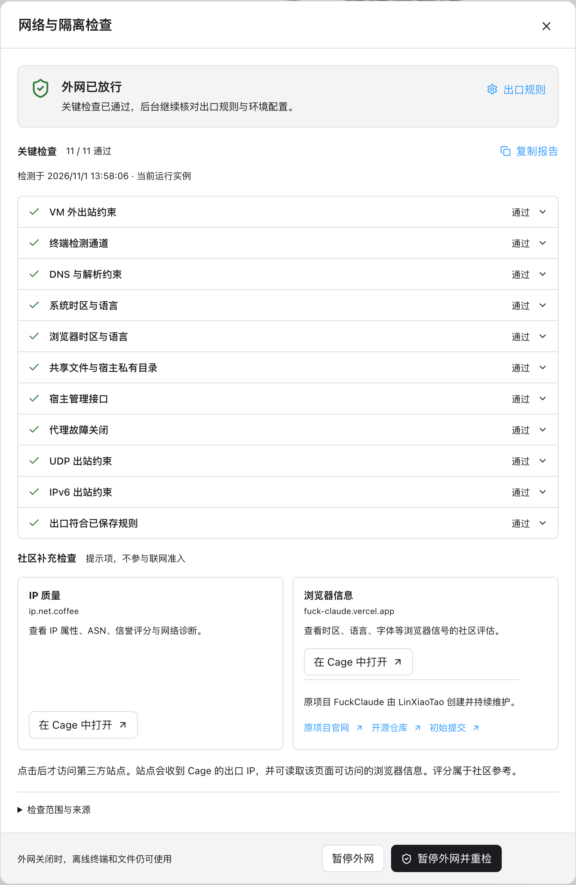
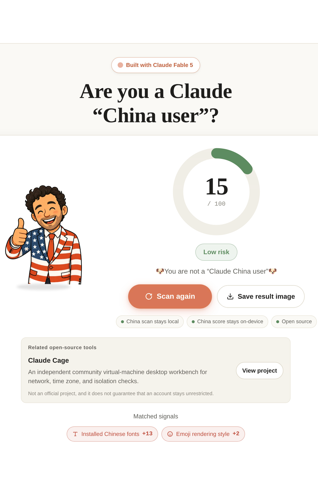
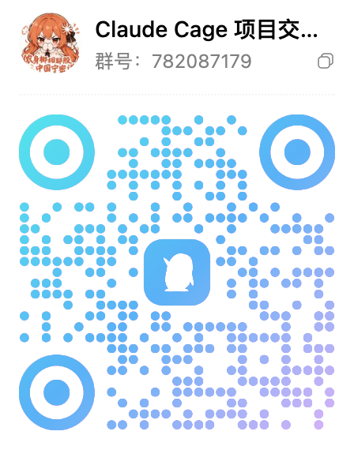

<div align="center">

<h1>Claude Cage</h1>

**把 Claude 大小姐關起來，為了更好地保護我們的相遇**


[](https://github.com/Lee-xeo/Claude-Cage/releases) [](LICENSE)

<a href="https://trendshift.io/repositories/339051#achievements"></a> <a href="https://trendshift.io/repositories/339051#achievements"></a>

<a href="https://trendshift.io/repositories/339051#achievements"></a> <a href="https://trendshift.io/repositories/339051#achievements"></a>

**[專案主頁](https://claude-cage.com/) · [下載應用程式](https://claude-cage.com/zh-TW/#download) · [開始使用](docs/getting-started.md) · [常見問題](docs/troubleshooting.md) · [使用文件（簡體中文）](https://claude-cage.com/docs/)**

[简体中文](README.md) · [繁體中文](README.zh-TW.md) · [Русский](README.ru.md) · [العربية](README.ar.md) · [فارسی](README.fa.md) · [한국어](README.ko.md) · [Español](README.es.md) · [မြန်မာဘာသာ](README.my.md) · [Беларуская](README.be.md) · [پښتو](README.ps.md) · [دری](README.prs.md) · [አማርኛ](README.am.md) · [Soomaali](README.so.md) · [ትግርኛ](README.ti.md) · [Français](README.fr.md)

</div>

## 設計理念

1. **Claude 本身是安全的，但它的執行外殼（harness）及相關程式不是**——包括 Claude Code、Claude Desktop，以及瀏覽器裡接觸到的郵件、網頁與環境訊號。
2. **想要在確保安全的前提下使用 Claude 的能力，通常有兩條路線：反向代理，或者遠端控制**——要麼把 Claude 從遠端伺服器拉出來直接跑在主機上，要麼把 Claude 部署在受控環境裡，由它遠端操作主機。我們認為後者更安全，也更合規。
3. **因此，Cage 的核心思想是：為 Claude 及相關程式打造一個輕量化的本機隔離環境，再透過標準 MCP 外掛，讓 Claude 安全、受控地使用本機能力**——每一次越出環境的呼叫都有明確的權限邊界與使用者確認，比直接暴露 SSH 更安全。

這樣一來，Cage 同時實現了三個目標：

- **把危險的部分關起來，把有用的能力放出來。** Claude 大小姐安心待在 Cage 裡，坐在她的小螃蟹上，只需把手伸出來處理外面的工作——不必在 Cage 裡重新搭一整間辦公室。
- **透過外掛市場，與開源社群解耦協作。** 我們開放了[外掛市場（cage-plugins）](https://github.com/Lee-xeo/cage-plugins)：**外掛 = MCP + 擴充**，分別對應「給 Claude 的能力」與「Cage 工作臺的客製化」。開源社群可以在外掛市場持續貢獻工具、桌面控制與工作流擴充，而不必擠進 Cage 主倉庫的 Issue 列表；Cage 核心維護團隊也能更聚焦於隔離環境、網路與工作臺本身的打磨。
- **合規、安全、輕量化、本機、低成本，一鍵安裝、一鍵配置、開箱即用。** 我們不再需要維護複雜臃腫的多系統客機，不再擔心 Claude 的能力被困在孤島裡，也無需承擔高昂的雲端成本或資料安全隱憂——在自己電腦上就能優雅地實現這一切。

## 受夠了 Anthropic

作為一個只是想和 Claude 對話與合作的正常使用者，受夠了折騰各種 VPS，指紋瀏覽器，環境檢測，面對封號的擔驚受怕和財產損失。我們提出 **Claude Cage** 專案：**一個開箱即用的桌面程式，配置好自己的網路代理，集中管理輕量化隔離環境、時區語言、環境檢查與外掛能力。**

Claude Cage 在一個小型的 Debian 13 環境裡執行官方 Claude Code 和 Claude Desktop，macOS、Windows 和 Linux 上都是同一個環境。終端、瀏覽器、編輯器、官方 Claude Desktop 與外掛市場集中在同一個工作臺，專案按需共享，網路獨立管理；既可以透過外掛安全呼叫本機能力，也能連接自己的伺服器，或用手機接續電腦上的工作。主要功能包括：

- 和主機隔離的網路設定，Cage 自己接管和代理內部的所有網路流量
- 和主機隔離的指紋設定，包括時區、語言等，支援自動與代理 IP 同步
- 針對 Claude 使用過程中的全鏈路適配（瀏覽器登入，授權，claude code 程序）
- 內建網路與隔離檢查，關鍵檢查失敗或證據不完整時暫停外網；社群和第三方檢測提供補充參考

**使用 Cage 的環境檢測結果：**

| 網路與隔離檢查 | 社群瀏覽器檢查 |
| :---: | :---: |
| <a href="assets/network-checks.png"></a> | <a href="assets/community-browser-check.png"></a> |

[FuckClaude](https://fuck-claude.vercel.app/) · [LinXiaoTao / GitHub](https://github.com/LinXiaoTao/FuckClaude)

**Cage 執行主介面：**


## 你可以用它做什麼

- **在本機終端機使用 Claude Code（v0.2.2 功能）。** `cage login` 會開啟 Cage 瀏覽器，讓你登入 Claude 帳號。在專案資料夾輸入 `cage claude` 即可共享目前的資料夾並以預設帳號開啟工作階段，支援 Claude Code 原生參數和管線。若這次要使用名為 `sarah` 的帳號，請輸入 `cage sarah`。單獨輸入 `cage` 可查看說明。`cage start` 可在背景預先啟動 Cage 服務與本機虛擬機器，等環境就緒後返回。`cage up` 可開啟桌面工作台或將視窗帶回前景。用 `cage update` 可直接在終端機更新 Cage。v0.2.2 的 npm 套件發布後，也可用 `npm install -g claude-cage` 安裝。 [終端機指令與範例](docs/guide/workbench.md#在本机终端使用-claude-code)
- **在一個視窗裡完成工作。** 用終端執行 Claude Code，用編輯器檢視改動，用 Cage 瀏覽器預覽服務和完成登入。
- **透過外掛市場解鎖全部能力。** 內建開放的[外掛市場（cage-plugins）](https://github.com/Lee-xeo/cage-plugins)，外掛 = MCP + 擴充：既能讓環境裡的 Claude 透過標準 MCP 安全、受控地使用本機能力（如桌面鍵鼠控制、Office 文件、Blender、命令列工具等），也能透過沙箱頁面客製化 Cage 工作臺。主機外掛預設受權限宣告與確認對話框保護。 [外掛與市場](docs/guide/plugins.md) · [開發規範](docs/plugins.md)
- **三個平台，同一個輕量化環境。** macOS、Windows 和 Linux 上的 Cage 都執行同一個輕量化 Debian 13 環境，無需維護複雜的多系統客機，工具與操作方式一致。 [Debian 環境](docs/guide/guest-systems.md)
- **控制共享範圍。** 只共享預設工作區和明確開啟的專案資料夾；主機的 Claude 登入、瀏覽器配置和 SSH 金鑰不會自動匯入。
- **看清網路狀態。** 內建代理管理支援匯入訂閱、選擇節點和檢查出口。關鍵檢查未透過時，環境保持離線；代理不可用時沒有直連回退。
- **下次繼續使用。** 工具、檔案和登入狀態儲存在虛擬磁碟裡，關閉視窗可以保留後臺任務。
- **管理多個 Claude Code 帳號。** 查看額度、為新會話分配帳號，並在明確授權後切換帳號接續歷史。 [Claude Code](docs/guide/accounts.md)
- **用手機接續工作。** Android / iPhone 透過 QR Code 或配對碼連接電腦，接續同一份 Claude Code 對話、傳送訊息和處理工具審批，也可操作遠端瀏覽器和電腦上的 Claude Desktop。
- **在雲端執行環境。** 透過 SSH 連接部署在符合條件的 Linux x86_64 VPS 上的 Cage，無需 KVM；資料與網路出口位於伺服器。
- **透過私網連接。** 在 Cage 內登入 Tailscale，讓本機與環境透過 SSH 雙向連接。 [Tailscale / SSH](docs/guide/tailscale.md)

## 快速開始

把這句話發給你的 agent（codex，dsh，workbuddy，反正不會是 claude code😁）

```markdown
幫我拉取 https://github.com/Lee-xeo/Claude-Cage 的最新原始碼，打包安裝，將我匯出的上游節點設定 [檔案路徑] 匯入 Cage。若使用代理鏈，請依序設定中繼節點和出口節點。確認對外的公用 IP 為 [預期 IP]。全程盯著，有問題直接修復，必要時順手向專案提交 issue，幫助改善相容性。
```

Clash/Mihomo 或 sing-box 在本機監聽的位址（如 `127.0.0.1:7890`）不能作為上游節點。 [遷移現有代理鏈](docs/guide/network.md#把原客户端的代理链迁到-cage)

你唯一需要的，是一個靠譜的代理節點，本專案不做任何代理推廣，可以自行搜尋黑色錯誤網站解決。

## 下載與安裝

Cage 支援 macOS、Windows 和 Linux：macOS 14+ 的 Apple Silicon Mac 與 Intel Mac、Windows 10 22H2 / 11 x64，以及 Debian 12 / Ubuntu 22.04 / 24.04 x86_64。Windows ARM64 和 Linux ARM64 尚不受支援。 [macOS](docs/getting-started.md) · [Windows](docs/windows.md) · [Linux](docs/linux.md)。

1. 開啟[專案主頁](https://claude-cage.com/zh-TW/#download)，點選「下載應用程式」並選擇平台。
2. macOS：開啟安裝包，將 **Cage** 拖入 **Applications（應用程式）**，再從“應用程式”啟動。Windows：[安裝說明](docs/windows.md#安装并开始工作) · Linux：[安裝說明](docs/linux.md#安装并开始工作)。
3. 按應用內引導配置自己的代理，啟動環境後開啟專案。

安裝包隨附工作臺和代理核心，無需先安裝 Go、Node.js、Docker 或 Clash。首次建立環境時選擇儲存位置，Cage 會下載 Debian 13 映像和開發工具。Cage 不提供代理服務或 Claude 帳戶。

原始碼與安裝包公開，版本說明和校驗檔案見 [Releases](https://github.com/Lee-xeo/Claude-Cage/releases)。

功能以所用建置為準，公開安裝包的能力與驗證範圍以發行說明為準。

macOS 和已簽章 Windows 版本支援透過所選代理更新；Windows 未簽章預覽版與 Linux 使用安裝包手動更新。更新前儲存並停止工作，個人資料繼續保留。 [升級與解除安裝](docs/guide/maintenance.md)

## 三步開始

### 1. 選擇代理

點選首頁“配置網路與代理”，再點選“新增來源”，匯入 Clash/Mihomo YAML 訂閱或本地 YAML 檔案，在“節點”中選擇一個節點。沒有可用代理時，可以明確勾選“透過主機網路下載這份訂閱”，或直接匯入本地檔案。後續可從“設定 → 網路與代理”管理節點。

### 2. 啟動環境

首次啟動時選擇儲存位置。點擊「啟動 Cage 環境」，按引導完成安裝；進度和錯誤可在「操作詳情」查看。以後啟動沿用原環境。

### 3. 開啟專案，執行 Claude

點選“開啟專案”選擇 本機 上的資料夾，再新建終端，輸入 `claude`，在 Cage 瀏覽器中完成自己的賬戶授權。也可以先使用預設工作區，無需提前準備專案。完整步驟見[開始使用](docs/getting-started.md)。

## 使用前瞭解這些邊界

- 共享專案中的修改和刪除會直接影響 本機 上的檔案。請使用版本控制或備份；專案內的 `.git` 可讀寫，可直接在 Cage 中暫存、提交與切換分支。
- 所有專案共用一個 Cage 環境，也共用其中的工具、賬戶與 Debian 檔案系統。專案之間沒有獨立隔離。
- 預設公網出站支援 IPv4 TCP，DNS 透過同一代理；公網 UDP、IPv6、ICMP 及主機和區域網路直連受限。主動啟用 Tailscale 後，可依私網權限連接裝置。
- 網路檢查展示當前配置和取樣證據，無法保證賬戶不會受到平臺限制，也不能代替完整的虛擬化安全審計。

詳細機制見[網路與資料邊界](docs/getting-started.md#网络与数据边界)。

## 文件與貢獻

完整入口見[文件導航](docs/README.md)。

| 你要做什麼 | 從這裡開始 |
|---|---|
| Debian 13 環境的要求、空間與資料保留 | [Debian 環境](https://claude-cage.com/docs/guest-systems/) |
| 第一次安裝、配置代理、開啟專案 | [開始使用](docs/getting-started.md) |
| 處理下載、啟動、聯網和登入問題 | [常見問題與恢復](docs/troubleshooting.md) |
| 瞭解按鍵、外觀、資料儲存和退出行為 | [日常使用](docs/getting-started.md#日常使用) |
| 報告可復現問題 | [GitHub Issues](https://github.com/Lee-xeo/Claude-Cage/issues) |
| 貢獻修正、功能或文件：Issue 審核 → 協作者邀請 → PR | [貢獻指南（簡體中文）](.github/CONTRIBUTING.md) |

本專案仍在快速迭代中，歡迎加入交流群提意見，歡迎社群大佬一起維護

| QQ 群 · 782087179 | 微信 |
| :---: | :---: |
| <a href="assets/community-qq.png"></a> | <a href="www/src/assets/community-wechat.png"></a> |

[Telegram](https://t.me/claude_cage)

## 來源與許可

Cage 基於 [agent-vm](https://github.com/sylvinus/agent-vm) 二次開發。

專案主許可為 [MIT](LICENSE)。隨附元件保留各自許可，Mihomo 作為獨立可執行檔案按 GPL-3.0 分發；請同時參閱 [NOTICE](NOTICE) · [第三方許可](THIRD_PARTY_LICENSES) · [noVNC](ui/vendor/novnc/LICENSE.txt)。

Cage 是獨立社群專案，與 Anthropic 無隸屬關係。

## 參考與致謝

感謝以下專案為 Cage 提供基礎能力或設計參考：

- [agent-vm](https://github.com/sylvinus/agent-vm)：Cage 的二次開發底座。
- [Lima](https://github.com/lima-vm/lima)：Linux 虛擬機器管理。
- [gvisor-tap-vsock](https://github.com/containers/gvisor-tap-vsock)：虛擬機器網路能力。
- [sshocker](https://github.com/lima-vm/sshocker) 和 [SFTP](https://github.com/pkg/sftp)：虛擬機器與主機之間的檔案共享能力。
- [noVNC](https://github.com/novnc/noVNC)：瀏覽器中的遠端畫面與互動。
- [Mihomo](https://github.com/MetaCubeX/mihomo)：內建代理核心。
- [code-server](https://github.com/coder/code-server)：瀏覽器中的程式碼編輯器。
- [AIO Sandbox](https://github.com/agent-infra/sandbox)：工作環境和互動體驗參考。
- [claude-switcher](https://github.com/YOURSJEYO/claude-switcher) 和 [Claude-Guardian](https://github.com/DUNHKpcc/Claude-Guardian)：網路檢查和安全診斷方法參考。
- [claude-post-ban-cleanup](https://github.com/l2461090/claude-post-ban-cleanup): 精確盤點、保護使用者資料與可復原快取清理的流程參考；Cage 獨立實作。


<a href="https://www.star-history.com/?repos=Lee-xeo%2FClaude-Cage&amp;type=date">
  <picture>
    <source media="(prefers-color-scheme: dark)" srcset="https://api.star-history.com/svg?repos=Lee-xeo/Claude-Cage&amp;type=Date&amp;theme=dark" />
    <source media="(prefers-color-scheme: light)" srcset="https://api.star-history.com/svg?repos=Lee-xeo/Claude-Cage&amp;type=Date" />
    
  </picture>
</a>
